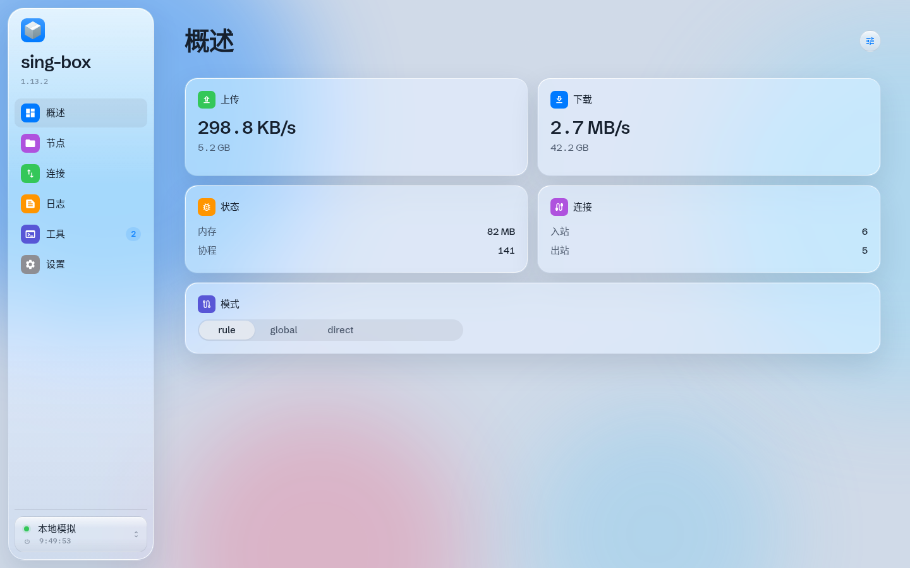
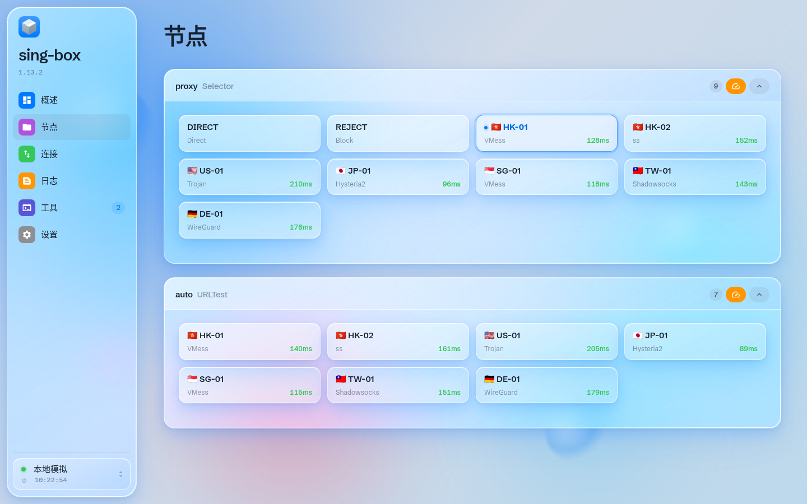
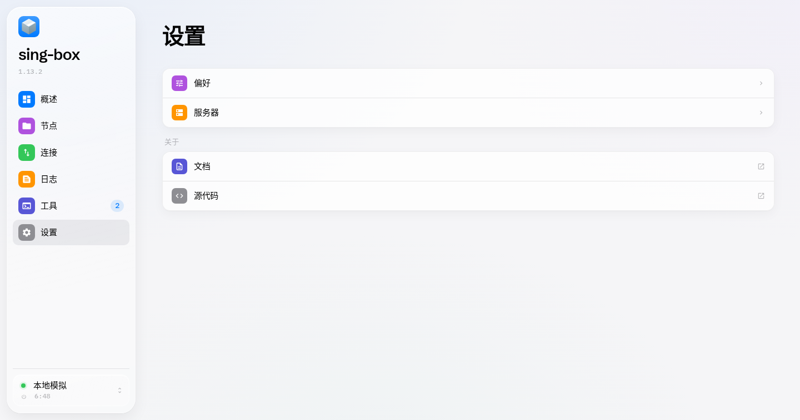

# muscboard

An unofficial, deeply customized fork of
[SagerNet/sing-box-dashboard](https://github.com/SagerNet/sing-box-dashboard) —
the web dashboard for [sing-box](https://sing-box.sagernet.org).

All credit for the original project goes to its author
[nekohasekai](https://github.com/nekohasekai) / the SagerNet team.
This project is a derivative work and is **not** affiliated with or endorsed
by the original authors.

## Download

Newest frontend build. The `latest` tag is moved on every release, so these URLs always fetch the current dist:

- [muboard.zip](https://github.com/vxzman/muscboard/releases/latest/download/muboard.zip)
- [muboard.tar.gz](https://github.com/vxzman/muscboard/releases/latest/download/muboard.tar.gz)

Same files via the `latest` tag:

- https://github.com/vxzman/muscboard/releases/download/latest/muboard.zip
- https://github.com/vxzman/muscboard/releases/download/latest/muboard.tar.gz

Dated snapshots (`YYYYMMDD`) stay on the [Releases](https://github.com/vxzman/muscboard/releases) page.

Project brief (purpose, aesthetic, code style, release, pitfalls): [docs/ENGINEERING.md](docs/ENGINEERING.md).

## Screenshots







## Customizations

- Crystal liquid glass over a moving color-pool canvas (thin 14% fill,
  32 / 22 / 12 px blur stack, specular sheen — not milky white cards).
- System Blue as the default accent; solid system-color icon tiles
  (upload green, download blue, speed-test orange).
- Pure-CSS isometric cardboard-box logo in the sidebar, mobile top bar
  and setup screen.
- Inset glass sidebar; Groups nodes use Dock-style magnification.
- Large-title metrics on Overview; proxy "Groups" is 「节点 / 節點」.

## Local run

```sh
./run/start.sh    # mock daemon :8090 + Vite :5173
```

In the setup form, URL is `http://127.0.0.1:8090` (secret optional).

## Keeping in sync with upstream

The repository keeps the full upstream commit history, so pulling newer
upstream changes is a normal merge:

```sh
git fetch origin
git merge origin/main
# or: git pull origin main
```

Resolve any conflicts (customization work is concentrated in
`src/styles/globals.css`, `src/styles/shared.css` and the view CSS modules),
then commit and push the fork remote only:

```sh
git push muboard
```

Tip: if upstream rewrites a lot, keep your customizations in dedicated
commits (or a dedicated branch) so each upstream merge is easier to review.

## LICENSE

```
Copyright (C) 2022 by nekohasekai <contact-sagernet@sekai.icu>

This program is free software: you can redistribute it and/or modify
it under the terms of the GNU General Public License as published by
the Free Software Foundation, either version 3 of the License, or
(at your option) any later version.

This program is distributed in the hope that it will be useful,
but WITHOUT ANY WARRANTY; without even the implied warranty of
MERCHANTABILITY or FITNESS FOR A PARTICULAR PURPOSE.  See the
GNU General Public License for more details.

You should have received a copy of the GNU General Public License
along with this program. If not, see <http://www.gnu.org/licenses/>.

In addition, no derivative work may use the name or imply association
with this application without prior consent.
```
